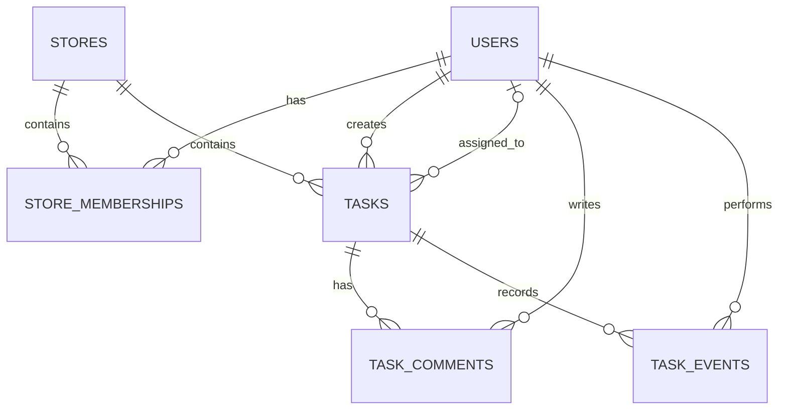

# Entity Relationship Diagram

## 1. Overview

The Kasbify Task Management API uses a relational database consisting of six core business entities:

- `users`
- `stores`
- `store_memberships`
- `tasks`
- `task_comments`
- `task_events`

The database uses PostgreSQL and enforces referential integrity through primary keys, foreign keys, unique constraints, and composite foreign keys.

The diagram below represents the logical relationships between the core entities.

## 2. Entity Relationship Diagram

## 3. Entity descriptions

| Entity | Description |
|---|---|
| `users` | Stores user account information. |
| `stores` | Represents stores in which tasks are managed. |
| `store_memberships` | Connects users to stores and defines their roles within each store. |
| `tasks` | Stores tasks belonging to a specific store. |
| `task_comments` | Stores comments written by store members on tasks. |
| `task_events` | Stores the activity and audit history of tasks. |

## 4. Relationship descriptions

| Relationship | Cardinality | Description |
|---|---|---|
| Users - Store Memberships | One-to-many | A user can have memberships in multiple stores. |
| Stores - Store Memberships | One-to-many | A store can have multiple members. |
| Stores - Tasks | One-to-many | Each task belongs to exactly one store. |
| Users - Tasks (creator) | One-to-many | Each task has exactly one creator. A user can create multiple tasks. |
| Users - Tasks (assignee) | One-to-many, optional | A task can have zero or one assignee. A user can be assigned multiple tasks. |
| Tasks - Task Comments | One-to-many | A task can have multiple comments. |
| Users - Task Comments | One-to-many | Each comment has exactly one author. |
| Tasks - Task Events | One-to-many | A task can have multiple events. |
| Users - Task Events | One-to-many | Each event has exactly one actor. |

## 5. Important database integrity rules

The logical diagram does not show every database constraint. The following rules are enforced through the migrations.

### 5.1. Store memberships

- `store_memberships.store_id` references `stores.id`.
- `store_memberships.user_id` references `users.id`.
- `(store_id, user_id)` is unique.
- A membership's role must be either `manager` or `staff`.
- A user can have different roles in different stores.
- A user cannot have multiple memberships in the same store.

### 5.2. Task integrity

Each task belongs to one store and has a creator. Its assignee is optional.

The database enforces the following composite foreign keys:

- `(store_id, created_by)` references `store_memberships(store_id, user_id)`.
- `(store_id, assigned_to)` references `store_memberships(store_id, user_id)`.

Consequently:

- The task creator must belong to the task's store.
- If assigned, the assignee must also belong to the task's store.
- A task cannot reference a member of another store as its creator or assignee.

The database also defines a unique constraint on `(store_id, id)` in `tasks`. This allows other tables to reference a task together with its store.

### 5.3. Comment integrity

The following composite foreign keys are enforced:

- `(store_id, task_id)` references `tasks(store_id, id)`.
- `(store_id, user_id)` references `store_memberships(store_id, user_id)`.

Consequently:

- A comment must reference a task belonging to the specified store.
- The comment author must be a member of that store.

### 5.4. Event integrity

The following composite foreign keys are enforced:

- `(store_id, task_id)` references `tasks(store_id, id)`.
- `(store_id, actor_id)` references `store_memberships(store_id, user_id)`.

Consequently:

- An event must reference a task belonging to the specified store.
- The event actor must be a member of that store.

### 5.5. Deletion behavior

Foreign keys use `ON DELETE RESTRICT`.

This prevents deletion of referenced records and protects historical information such as task comments and task events from being removed through cascading deletes.

## 6. Supporting tables

In addition to the six core entities, the application uses supporting tables:

| Table | Purpose |
|---|---|
| `personal_access_tokens` | Stores Laravel Sanctum personal access tokens. |
| `password_reset_tokens` | Stores password reset tokens. |
| `sessions` | Stores session information when database-backed sessions are used. |
| `jobs` | Stores queued jobs when the database queue driver is used. |
| `job_batches` | Stores queue batch information. |
| `failed_jobs` | Stores jobs that failed during execution. |

These tables support authentication, session management, and background job processing. They are excluded from the core business ER diagram because they do not represent the task-management domain relationships.
